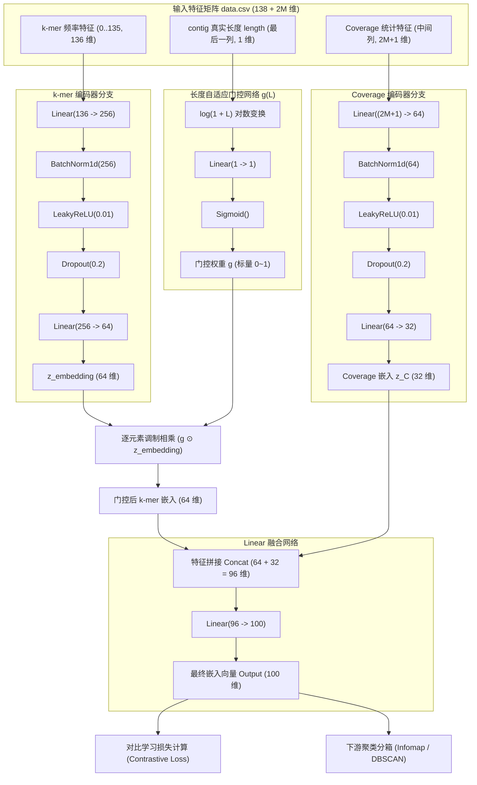

# NewBin 工作进展记录与后续开发规划

> **最新记录时间**：2026-10-10  
> **当前状态**：数据准备、特征工程与核心模型网络架构（`NewBinModel`）已就绪，进入训练循环（DataLoader & Contrastive Loss）实现阶段。

---

## 一、 历史工作记录（2026-10-09 完成）

1. **确定输入数据格式与规范**
   - 规范 Contig FASTA 命名规则（多样本支持 `sample:contig` 格式）及 $\ge 1000\text{ bp}$ 过滤阈值；
   - 规范排序比对文件（Sorted BAM）；
   - 对接外部准备好的先验约束数据（`must_link.csv` / `cannot_link.csv`）。

2. **剪除切片（Split）伪造正样本冗余**
   - 彻底删除原 SemiBin 将长 contig 对半切分伪造 must-link 的逻辑；
   - 移除 `must_link_threshold` 长度计算与报错拦截；
   - 移除 `data_split.csv`、`data_split_cov.csv` 等切片计算与磁盘 I/O。

3. **K-mer 序列特征提取优化**
   - 确立 136 维 Canonical 4-mer 特征提取与行归一化；
   - 采用 2-bit 向量化查找表（LUT）大幅加速提取过程，天然过滤非标准碱基。

4. **落地新版 Coverage 特征工程（$2M + 1$ 维）**
   - **均值与方差提取**：各 BAM 流式统计位置级均值 $\mu$ 与方差 $\sigma^2$（去除两端 75 bp 边界效应）；
   - **$2M + 1$ 维特征变换**：
     - **Level（1 维）**：行均值 $\text{mean}(\ln(\mu + \varepsilon))$，表示全局测序水准；
     - **Shape（$M$ 维）**：$\ln(\mu + \varepsilon) - \text{Level}$，抹平拷贝数倍数偏差，行和为 0；
     - **$\log\mathrm{ID}$（$M$ 维）**：离散指数对数 $\ln(\sigma^2 / (\mu + \varepsilon))$，度量内部覆盖均匀性。

5. **流水线收敛与测试验证**
   - 编写并跑通 4 样本数值单元测试（`test_kmer_and_cov.py`），验证 9 维结构及偏差消除特性（6 项测试全部通过）。

---

## 二、 今日工作进展（2026-10-10 完成）

### 1. 特征构造端追加 Contig 长度（`length`）特征
* **底层提取支持**：在 `generate_kmer.py` 的 `generate_kmer_features_from_fasta` 中增加 `return_lengths=True` 参数，在流式读取 FASTA 时同步记录每条序列的真实碱基长度 `len(seq)`；
* **末尾列追加规范**：在 `main.py`（单样本与多样本流水线）中，将 contig 序列长度作为最后一列追加至 `data.csv`；
* **特征矩阵结构定型**：
  $$\text{data.csv 列分布} = \underbrace{[0 \dots 135]}_{\text{4-mer (136维)}} \ + \ \underbrace{[\text{cov\_level}, \text{cov\_shape}, \text{cov\_log\_id}]}_{\text{Coverage (2M+1维)}} \ + \ \underbrace{[\text{length}]}_{\text{Contig 长度 (1维)}}$$
  矩阵总列数为 **$138 + 2M$ 维**。

### 2. 重构训练数据与约束读取逻辑（`train_model` 第 1 部分）
* **彻底移除 `data_split`**：全面废弃旧版的伪造切片逻辑，改为主流先验约束传参（`must_link` 与 `cannot_link`）；
* **完整保留特征列**：移除了原版丢弃覆盖度的 `[:, :136]` 切片，动态获取总特征列数；
* **构建双向索引映射**：生成 `contig2idx = {name: idx}` 字典，使字符串格式约束与数值张量快速对齐；
* **约束清洗与去重**：自动过滤不存在于特征表中的无效 contig、剔除自环（$c_1 == c_2$），并按无向对 `tuple(sorted([c1, c2]))` 进行去重。

### 3. 落地深度双分支特征编码与门控网络（`NewBinModel`）
* **k-mer 编码器分支**：
  两层 MLP：$\text{Linear}(136 \to 256) \to \text{BatchNorm1d} \to \text{LeakyReLU}(0.01) \to \text{Dropout}(0.2) \to \text{Linear}(256 \to 64)$，输出 64 维 $z_{\text{kmer}}$；
* **长度自适应门控网络 $g(L)$**：
  输入 contig 长度 $L$，经 $\log(1 + L) \to \text{Linear}(1 \to 1) \to \text{Sigmoid}$ 得到标量权重 $g \in (0, 1)$。
  通过调制相乘 $\tilde{z}_{\text{kmer}} = g \cdot z_{\text{kmer}}$（64 维），使得较短 contig 的高噪声 k-mer 权重自动衰减；
* **Coverage 编码器分支**：
  两层 MLP：$\text{Linear}(2M+1 \to 64) \to \text{BatchNorm1d} \to \text{LeakyReLU}(0.01) \to \text{Dropout}(0.2) \to \text{Linear}(64 \to 32)$，输出 32 维 $z_C$；
* **特征拼接与 Linear 融合**：
  拼接门控 k-mer（64 维）与 Coverage（32 维）得到 96 维拼接向量，经单层 $\text{Linear}(96 \to 100)$ 融合投影，稳定输出 **100 维** 最终嵌入向量（完全契合下游 100 维分箱聚类接口）。

### 4. 模型架构流程图



### 5. 配套模型单元测试（`newbin/tests/test_model.py`）
新建了全面的模型测试文件，验证了：
- **维度恒定性**：在纯 k-mer（137 维）及含 Coverage（146 维）输入下，均稳定输出预期的嵌入维度；
- **门控单调性**：验证 $g(L)$ 输出严格在 $(0, 1)$ 区间，且随序列长度自适应响应；
- **全链路梯度流通**：反向传播验证，确保梯度同时有效流经 k-mer 分支、门控网络、Coverage 分支和 Fusion 层；
- **双塔孪生推理**：验证 `forward(x1, x2)` 输出两组嵌入用于对比学习；
- **权重存取一致性**：验证 `save_with_params_to` 和 `model_load` 保存后精确重载。

### 6. 双轨联合损失函数体系实现（`newbin/newbin/loss.py`）
根据《宏基因组分箱模型：损失函数计算与代码实现手册》，完成了生产级损失函数模块的编写与集成：

```
                    ┌──────────────────────────┐
                    │ 最终 Embedding z (100维) │
                    └────────────┬─────────────┘
                                 │
                                 ▼
                     ┌───────────────────────┐
                     │ 主损失 L_main         │ (全局物种判别: Hinge / InfoNCE)
                     └───────────────────────┘
                                 ▲
                     ┌───────────┴───────────┐
                     │  联合损失 L_total     │ L_total = L_main + λ * L_co
                     └───────────┬───────────┘
                                 ▲
                     ┌───────────┴───────────┐
                     │ 辅助损失 L_co         │ (分支共丰度保真: MSE(cos, r_ij))
                     └───────────────────────┘
                                 ▲
                    ┌────────────┴─────────────┐
                    │ Coverage 嵌入 Z_C (32维) │
                    └──────────────────────────┘
```

- **主损失函数 $\mathcal{L}_{\text{main}}$**：
  - `ContrastiveHingeLoss`：工作在原生欧氏距离空间，优化目标为 $\frac{1}{|P|} \sum [ y \cdot d^2 + (1 - y) \cdot \max(0, \text{margin} - d)^2 ]$，对齐 SemiBin 基线；
  - `SupConLoss`（有监督对比损失 / InfoNCE）：融合输出经过 $L_2$ 归一化投影至超球面，利用 Softmax 分母在超球面上建立全局互斥场，超参数 $\tau=0.1$。
- **共丰度辅助损失 $\mathcal{L}_{\text{co}}$（`CoAbundanceAuxiliaryLoss`）**：
  - 基于对数中心化 Shape 剖面 $d_i = \ln(\mu_i) - m_i$（$\bar{d_i}=0$），向量余弦相似度严格等于皮尔逊相关系数 $r_{ij} = \cos(d_i, d_j)$；
  - 强制 Coverage 网络输出 $Z_C$ 的余弦夹角逼近 $r_{ij}$：$\mathcal{L}_{co} = \frac{1}{|mask|} \sum_{i \ne j} (\cos(Z_{C,i}, Z_{C,j}) - r_{ij})^2$；
  - 包含最小样本数门槛旁路：当样本数 $M \le 2$ 时，自动置 0 跳过辅助损失。
- **核心物理约束：严格的梯度流隔离**：
  - $\mathcal{L}_{\text{co}}$ 挂在 $Z_C$ 输出端，反向传播完全被圈在 Coverage 编码器内部；
  - **绝不**流向门控网络 $g(L)$ 与 k-mer 编码器，防止短序列 Coverage 噪声导致门控失去“长度-置信度”真实物理含义。
- **联合损失包装器（`MetagenomicPipelineLoss`）**：
  - 统一封装 $\mathcal{L}_{\text{total}} = \mathcal{L}_{\text{main}} + \lambda \, \mathcal{L}_{co}$（默认 $\lambda=0.1$）；
  - 支持 Batch 矩阵模式与孪生成对输入模式。
- **模型接口增强（`newbin/newbin/model.py`）**：
  - `embedding` 与 `forward` 扩展 `return_zc: bool = False` 参数，训练时可同时提取最终向量 $z$ 与 Coverage 向量 $Z_C$。
- **配套单元测试（`newbin/tests/test_loss.py`）**：
  - 验证 $d_{\text{shape}}$ 切片提取；
  - 验证数值手算推导（$r_{ik}=1.00, r_{im} \approx -0.76$）；
  - 验证 $M \le 2$ 阈值旁路；
  - **物理隔离验证**：验证仅反向传播 $\mathcal{L}_{\text{co}}$ 时，`cov_encoder` 获得有效梯度，而 `kmer_encoder`、`gate`、`fusion` 梯度严格为 `None`。

---

## 三、 当前系统状态（现状）

- **数据与特征工程层（已就绪 ✓）**：
  FASTA + BAMs $\longrightarrow$ 提取 136 维 4-mer + $(2M+1)$ 维 Coverage + 1 维 length $\longrightarrow$ 输出规范 `data.csv`（$138+2M$ 维）。
- **模型网络定义层（已就绪 ✓）**：
  `NewBinModel`（两层 k-mer MLP + 长度门控 + 两层 Coverage MLP + Linear 融合）已实现，支持 `return_zc`。
- **损失函数层（已就绪 ✓）**：
  `newbin/newbin/loss.py`（双轨主损失 + 共丰度辅助损失 + 梯度隔离）已实现并通过专项单元测试验证。
- **训练循环层（当前推进 ⏳）**：
  `train_model` 内部基于 `MetagenomicPipelineLoss` 的 Dataset/DataLoader 组装、负采样平衡与训练循环待联调。

---

## 四、 后续工作规划（要做）

### 任务 1：构建约束集 Dataset 与 DataLoader
- 基于清洗后的 `must_pairs`（正对，label=1）与 `cannot_pairs`（负对，label=0）构建 PyTorch Dataset；
- 实现负样本下采样策略，控制每个 Batch 内正负对比例维持在 **$1:1 \sim 1:3$**；
- 构造 DataLoader，批量产出 `(x1, x2, label)` 张量。

### 任务 2：实现 train_model 训练循环与权重持久化
- 接入 `MetagenomicPipelineLoss(main_loss_type='hinge' 或 'supcon', lambda_co=0.1)` 计算联合损失；
- 配置优化器（AdamW）、学习率调度（CosineAnnealingLR 或 StepLR）与 Loss 监控；
- 训练完成后将权重及超参导出为 `model.pt`。

### 任务 3：端到端小规模测试验证
- 利用 `newbin/tests/test_data/` 目录下的真实小样本数据（`contigs.fasta`、`sample.sorted.bam`、`must_link.csv`、`cannot_link.csv`）跑通完整特征提取 $\to$ 模型训练 $\to$ 权重输出闭环。

### 任务 4：推理嵌入与下游分箱聚类对接
- 模型切换 `eval()` 模式对全体 contig 输出 100 维 embedding；
- 对接下游 `cluster.py`（Infomap）与 `long_read_cluster.py`（DBSCAN），验证最终分箱 FASTA 输出。
