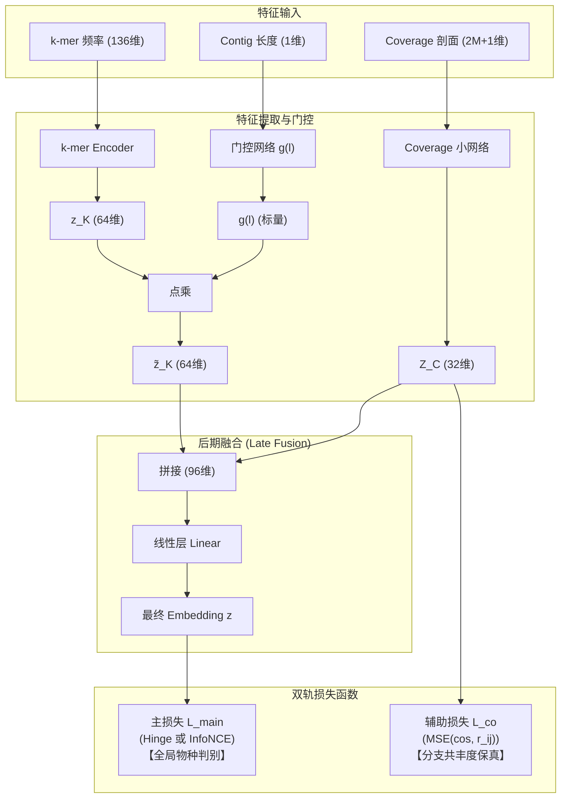
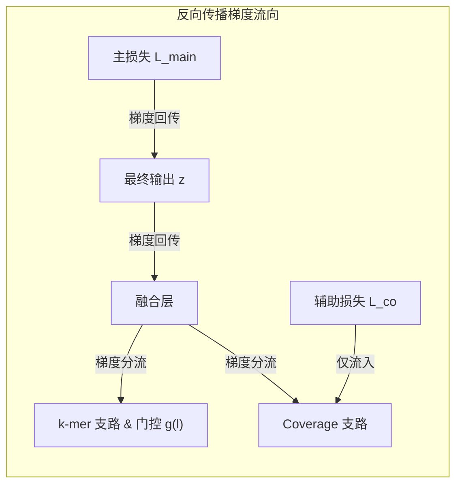

# 宏基因组分箱模型：损失函数计算与代码实现手册

> **文档说明**：本文档详细整理了当前宏基因组分箱（Metagenomic Binning）模型中的**双轨损失函数架构**、**主损失函数（Hinge 与 InfoNCE）**、**共丰度辅助损失 $\mathcal{L}_{co}$** 以及核心相关系数 $r_{ij}$ 的数学推导、计算细节与完整 PyTorch 生产级代码实现。

---

## 一、 整体损失函数架构概览

模型采用“**主损失 + 分支辅助损失**”的联合监督机制：

$$\mathcal{L} = \mathcal{L}_{\text{main}} + \lambda \, \mathcal{L}_{co}$$



### 核心设计原则：“四个 Embedding，只有两个进损失”
1. **$z_K$ / $\tilde{z}_K$（k-mer 支）**：**不直接参与任何损失**。k-mer 编码器与长度门控 $g(l)$ 完全通过融合层回传的主损失梯度进行端到端优化。
2. **$Z_C$（Coverage 支）**：直接接入辅助损失 $\mathcal{L}_{co}$，作为分支内正则化，确保低维压缩时不丢掉共丰度波动的相关性。
3. **$z$（融合最终输出）**：接入主损失 $\mathcal{L}_{\text{main}}$，负责拉近同物种、推开异物种。

---

## 二、 辅助损失 $\mathcal{L}_{co}$ 与 $r_{ij}$ 的深度拆解

### 2.1 物理动机与定义
同一微生物基因组的 contig 在不同宏基因组样本中，其丰度涨落应保持同频共振（Co-abundance）。辅助损失的目标是**强约束 Coverage 小网络的输出空间 $Z_C$，使其在角度上精确保持原始输入中的跨样本相关性**：

$$\mathcal{L}_{co} = \big( \cos(Z_{C,i}, Z_{C,j}) - r_{ij} \big)^2$$

- $\cos(Z_{C,i}, Z_{C,j})$：Coverage 网络对 contig $i$ 和 $j$ 预测出的特征夹角余弦相似度。
- $r_{ij}$：contig $i$ 与 $j$ 真实跨样本丰度波动的相关系数。

---

### 2.2 $r_{ij}$ 的前置步骤：提取 Shape 特征向量 $d_i$

设共有 $M$ 个测序样本，contig $i$ 在各样本中的平均深度为 $\mu_i = [\mu_i^{(1)}, \mu_i^{(2)}, \dots, \mu_i^{(M)}]$。

```
原始均值剖面 μ_i (M维)
       ↓  加伪计数 ε 后取自然对数 (乘性偏差转为加性偏差)
log(μ_i) = [ln(μ_i^(1)), ..., ln(μ_i^(M))]
       ↓  计算该行沿样本维度的平均值 (提取整体丰度水平)
level m_i = mean(log(μ_i))
       ↓  广播相减 (消除序列自身易测/难测、拷贝数等乘性偏差)
shape d_i = log(μ_i) - m_i   <--- 此时每一行的元素和恒为 0
```

> [!IMPORTANT]
> **关键数学性质**：由于 $d_i$ 减去了自身均值 $m_i$，因此 **$d_i$ 向量的内部元素均值恒为 0**：
> $$\sum_{s=1}^M d_i^{(s)} = 0 \iff \bar{d_i} = 0$$

---

### 2.3 $r_{ij}$ 的计算公式与数学证明

两条 contig 之间的共丰度相关度 $r_{ij}$ 直接定义为 Shape 向量 $d_i$ 与 $d_j$ 的**余弦相似度**：

$$r_{ij} = \cos(d_i, d_j) = \frac{d_i \cdot d_j}{\|d_i\|_2 \, \|d_j\|_2} = \frac{\sum_{s=1}^M d_i^{(s)} d_j^{(s)}}{\sqrt{\sum_{s=1}^M (d_i^{(s)})^2} \sqrt{\sum_{s=1}^M (d_j^{(s)})^2}}$$

#### 为什么余弦相似度等于皮尔逊相关系数？
皮尔逊相关系数标准公式为：
$$\mathrm{Pearson}(X, Y) = \frac{\sum_{s=1}^M (X_s - \bar{X})(Y_s - \bar{Y})}{\sqrt{\sum_{s=1}^M (X_s - \bar{X})^2} \sqrt{\sum_{s=1}^M (Y_s - \bar{Y})^2}}$$
因为我们在预处理阶段已经中心化，$\bar{d_i} = 0, \bar{d_j} = 0$，上式中的均值项自动消失：
$$\mathrm{Pearson}(d_i, d_j) = \frac{\sum d_i^{(s)} d_j^{(s)}}{\|d_i\|_2 \|d_j\|_2} \equiv \cos(d_i, d_j)$$
**结论**：在对数中心化（CLR）空间中，**向量余弦相似度在数学上严格等于对数尺度的皮尔逊相关系数**。这省去了在训练过程中频繁调用复杂统计库的开销。

---

### 2.4 手算数值推导演示

设 $M=4$ 个样本：
- Contig $i$（基准序列）：$\mu_i = [10, 50, 30, 5]$
- Contig $k$（同基因组，但因拷贝数折叠导致深度整体放大 3 倍）：$\mu_k = [30, 150, 90, 15]$
- Contig $m$（不同物种，丰度平缓）：$\mu_m = [25, 20, 24, 26]$

#### 步骤 1：取自然对数
- $\ln(\mu_i) = [2.303, 3.912, 3.401, 1.609]$
- $\ln(\mu_k) = [3.401, 5.011, 4.500, 2.708]$（每一项恰好比 $i$ 大 $\ln 3 \approx 1.099$）

#### 步骤 2：求各自行均值（Level）
- $m_i = (2.303 + 3.912 + 3.401 + 1.609) / 4 = 2.806$
- $m_k = (3.401 + 5.011 + 4.500 + 2.708) / 4 = 3.905$（整整吸收了 $\ln 3$ 的偏差）

#### 步骤 3：中心化得到 Shape 特征 $d$
- $d_i = \ln(\mu_i) - m_i = [-0.504, +1.106, +0.595, -1.197]$
- $d_k = \ln(\mu_k) - m_k = [-0.504, +1.106, +0.595, -1.197]$

#### 步骤 4：计算目标相关系数 $r$
- $r_{ik} = \cos(d_i, d_k) = \mathbf{1.00}$（彻底消除了 3 倍偏差，完美对齐！）
- $r_{im} = \cos(d_i, d_m) = \mathbf{-0.76}$（异种呈反向波动）

---

## 三、 主损失函数 $\mathcal{L}_{\text{main}}$ 的两种实现

### 3.1 方案 A：Contrastive Hinge Loss（对齐基线）
工作在原生欧氏距离空间，主要用于对比 SemiBin2：

$$\mathcal{L}_{\text{hinge}} = \frac{1}{|P|} \sum_{(i,j) \in P} \Big[ y_{ij} \, d(z_i, z_j)^2 + (1 - y_{ij}) \max\{1 - d(z_i, z_j), \, 0\}^2 \Big]$$

- $y_{ij} = 1$（Must-link，同物种）：惩罚 $d(z_i, z_j)^2$，迫使距离缩减为 0。
- $y_{ij} = 0$（Cannot-link，不同物种）：当 $d(z_i, z_j) < 1$ 时惩罚 $(1 - d)^2$，推远至距离大于等于 1 后损失归零。

### 3.2 方案 B：Supervised Contrastive Loss (SupCon / InfoNCE)（推荐主方案）
在融合层输出后对 $z$ 执行 $L_2$ 归一化（$\|z\|_2 = 1$），投影至超球面。对于 Batch 内样本 $i$：

$$\mathcal{L}_{\text{supcon}} = \sum_{i \in I} \frac{-1}{|P(i)|} \sum_{p \in P(i)} \log \frac{\exp(z_i \cdot z_p / \tau)}{\sum\limits_{a \in A(i)} \exp(z_i \cdot z_a / \tau)}$$

- $P(i)$：Batch 内与样本 $i$ 属于同物种的所有正样本集合。
- $A(i)$：Batch 内排除样本 $i$ 本身的所有其他样本。
- $\tau$：温度超参数（建议 $\tau = 0.1$）。
- **优势**：Softmax 分母在超球面上建立全局互斥场，对高相似度的难负样本（Hard Negative）产生指数级大梯度，彻底抑制表征坍缩。

---

## 四、 梯度流隔离：为什么 $\mathcal{L}_{co}$ 挂在 $Z_C$ 极其关键？



1. **若错误地挂在 $z$ 上**：梯度会通过融合层倒灌进门控网络 $g(l)$。短序列 coverage 噪声大时会导致 $r_{ij}$ 偏低，网络为了降低辅助损失，会投机性地降低 $g(l)$，使得门控失去真实的“长度-置信度”物理含义。
2. **挂在 $Z_C$ 上**：融合层位于 $Z_C$ 的下游，$\mathcal{L}_{co}$ 的反向传播完全被圈在 Coverage 小网络内部。这保证了门控 $g(l)$ 的纯净性。

---

## 五、 完整 PyTorch 代码实现

以下提供可直接集成的损失函数模块实现：

```python
import torch
import torch.nn as nn
import torch.nn.functional as F


class CoAbundanceAuxiliaryLoss(nn.Module):
    """
    共丰度辅助损失函数 L_co:
    强制 Coverage 小网络输出 Z_C 在余弦空间上复现输入的真实对数皮尔逊相关系数 r_ij
    """
    def __init__(self, min_samples_threshold: int = 2):
        super().__init__()
        self.min_samples_threshold = min_samples_threshold

    def forward(self, z_c: torch.Tensor, d_shape: torch.Tensor) -> torch.Tensor:
        """
        参数:
            z_c: Coverage 小网络输出，形状 (B, D_c)，例如 (B, 32)
            d_shape: 预处理后的 Shape 特征，形状 (B, M)，M 为样本数
        返回:
            loss_co: 标量损失
        """
        batch_size, num_samples = d_shape.shape

        # 样本数 <= 2 时 shape 特征自由度过低或退化，不施加辅助约束
        if num_samples <= self.min_samples_threshold:
            return torch.tensor(0.0, device=z_c.device, dtype=z_c.dtype)

        # 1. 计算真实目标相似度矩阵 r (B, B)
        # d_shape 已做中心化 (均值为0)，L2 归一化后做点积即为对数 Pearson 相关系数
        d_norm = F.normalize(d_shape.detach(), p=2, dim=1)
        r_target = torch.matmul(d_norm, d_norm.T)  # (B, B)

        # 2. 计算网络预测相似度矩阵 s (B, B)
        zc_norm = F.normalize(z_c, p=2, dim=1)
        s_pred = torch.matmul(zc_norm, zc_norm.T)  # (B, B)

        # 3. 计算均方误差 (排除自身对自身的对角线元素)
        mask = ~torch.eye(batch_size, dtype=torch.bool, device=z_c.device)
        loss_co = torch.mean((s_pred[mask] - r_target[mask]) ** 2)

        return loss_co


class SupConLoss(nn.Module):
    """
    有监督对比损失 Supervised Contrastive Loss (SupCon / InfoNCE)
    """
    def __init__(self, temperature: float = 0.1):
        super().__init__()
        self.temperature = temperature

    def forward(self, z: torch.Tensor, labels: torch.Tensor) -> torch.Tensor:
        """
        参数:
            z: 最终融合 Embedding，形状 (B, D)，必须已做 L2 归一化
            labels: 标签向量，形状 (B,)，整数物种 ID
        """
        device = z.device
        batch_size = z.shape[0]

        # 构造正样本掩码: labels 相同且非对角线自身
        labels = labels.contiguous().view(-1, 1)
        mask = torch.eq(labels, labels.T).float().to(device)
        diag_mask = torch.eye(batch_size, dtype=torch.bool, device=device)
        mask = mask.masked_fill(diag_mask, 0.0)

        # 相似度矩阵 / tau
        sim = torch.matmul(z, z.T) / self.temperature

        # 数值稳定性处理：减去每行最大值
        logits_max, _ = torch.max(sim, dim=1, keepdim=True)
        logits = sim - logits_max.detach()

        # 计算分母 log-sum-exp (排除自身)
        logits_mask = (~diag_mask).float()
        exp_logits = torch.exp(logits) * logits_mask
        log_prob = logits - torch.log(exp_logits.sum(1, keepdim=True) + 1e-12)

        # 计算正样本均值似然
        pos_per_row = mask.sum(1)
        valid_rows = pos_per_row > 0

        mean_log_prob_pos = (mask * log_prob).sum(1)[valid_rows] / pos_per_row[valid_rows]
        loss = -mean_log_prob_pos.mean()

        return loss


class MetagenomicPipelineLoss(nn.Module):
    """
    模型整体联合损失包装器:
    L_total = L_main + lambda * L_co
    """
    def __init__(self, main_loss_type: str = "supcon", lambda_co: float = 0.1, temperature: float = 0.1):
        super().__init__()
        self.lambda_co = lambda_co
        self.main_loss_type = main_loss_type.lower()

        if self.main_loss_type == "supcon":
            self.main_loss_fn = SupConLoss(temperature=temperature)
        else:
            raise ValueError(f"未知的损失函数类型: {main_loss_type}")

        self.co_loss_fn = CoAbundanceAuxiliaryLoss()

    def forward(
        self,
        z: torch.Tensor,
        z_c: torch.Tensor,
        d_shape: torch.Tensor,
        labels: torch.Tensor
    ) -> dict:
        """
        参数:
            z: 融合层输出最终特征 (B, D)
            z_c: Coverage 小网络输出特征 (B, D_c)
            d_shape: 原始 Coverage Shape 剖面 (B, M)
            labels: 样本标签 (B,)
        返回:
            {"total_loss": ..., "main_loss": ..., "co_loss": ...}
        """
        # 1. 最终特征 L2 归一化进入超球面
        z_norm = F.normalize(z, p=2, dim=1)

        # 2. 计算主损失
        l_main = self.main_loss_fn(z_norm, labels)

        # 3. 计算辅助共丰度损失
        l_co = self.co_loss_fn(z_c, d_shape)

        # 4. 联合加权求和
        total_loss = l_main + self.lambda_co * l_co

        return {
            "total_loss": total_loss,
            "main_loss": l_main,
            "co_loss": l_co
        }
```

---

## 六、 核心超参数配置与调优建议

| 超参数 | 建议初值 | 调试范围 | 物理作用与调优指南 |
| :--- | :--- | :--- | :--- |
| **$\lambda$ (辅助损失权重)** | `0.1` | `0.01 ~ 0.5` | 控制共丰度保真与聚类判别的平衡。若设置过大，网络会倾向于让 $Z_C$ 机械拟合 $d$，削弱主损失对聚类的影响。 |
| **$\tau$ (温度系数)** | `0.1` | `0.05 ~ 0.2` | $\tau$ 越小，对高相似度的难负样本（易混淆物种）惩罚越强烈；$\tau$ 过小可能导致梯度震荡。 |
| **Hard Negative 比例** | `67%` | `33% ~ 100%` | 采样构造负样本时，保持约 $2/3$ 为 k-mer 极相近但标签不同的 hard negatives，逼迫网络向 Coverage 特征寻求解题线索。 |
| **最小样本门槛 $M$** | `5` | - | 真实测序样本数 $M \ge 5$ 时共丰度信号极佳；若 $M \le 2$，应自动跳过辅助损失计算（$\lambda=0$）。 |

